* Misaka's keyboard config
#+ATTR_HTML: :title Build ZMK firmware
[[https://github.com/chuxubank/keyboard-config/actions/workflows/build.yml][https://github.com/chuxubank/keyboard-config/actions/workflows/build.yml/badge.svg]]

#+ATTR_HTML: :title Draw ZMK keymaps
[[https://github.com/chuxubank/keyboard-config/actions/workflows/draw-keymaps.yml][https://github.com/chuxubank/keyboard-config/actions/workflows/draw-keymaps.yml/badge.svg]]

** Silakka54

Converted from the previous Lily58 setup to the Silakka54 split layout with new shields,
keymap, and keymap-drawer config.

*** Flashing
Download the left and right =.uf2= files from a
[[https://github.com/chuxubank/keyboard-config/releases][release]].
The left half is the central: only it sends keys over USB or Bluetooth.

1. Double-tap reset on the nice!nano. A drive named =NICENANO= appears.
2. Copy that half's UF2 onto the drive. It unmounts and reboots when the flash finishes.
3. Flash the left half first, then the right. Power or reset both halves together so they pair.
